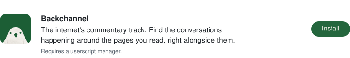
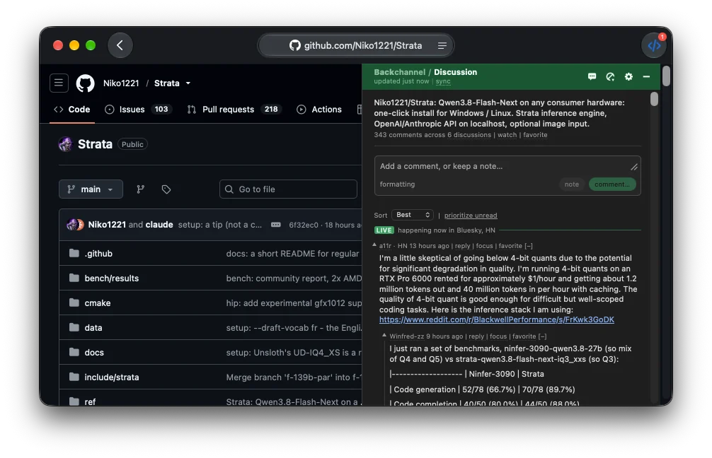
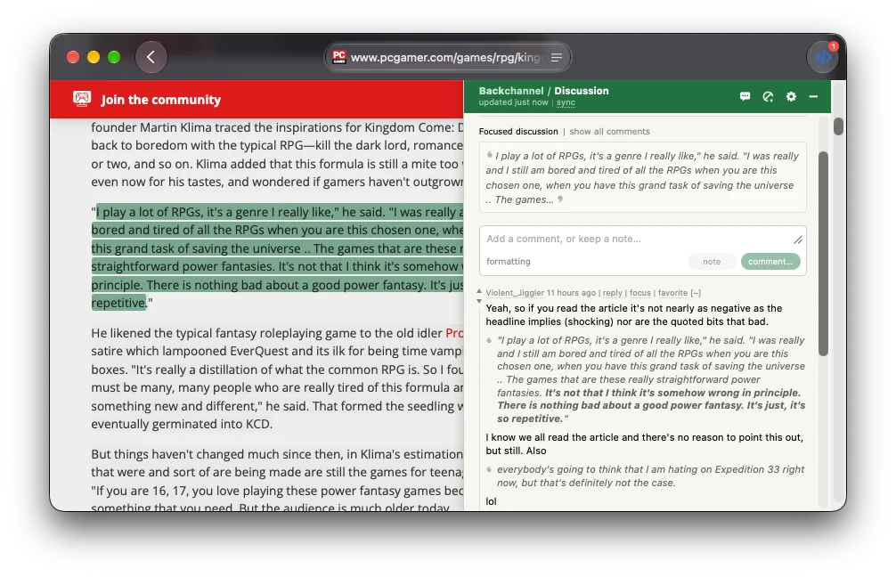
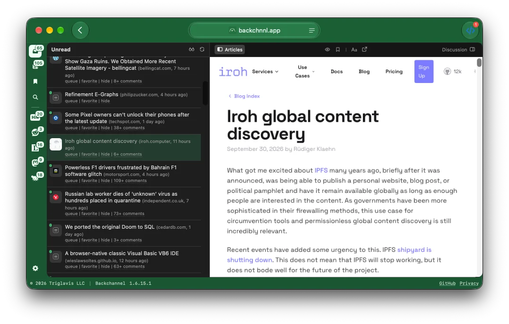

<a name="install"></a>
<p align="center"><a href="https://raw.githubusercontent.com/twalichiewicz/Backchannel/refs/heads/main/HNewhere.user.js"><picture><source media="(prefers-color-scheme: dark) and (max-width: 900px)" srcset="site/src/readme-header-mobile-dark.svg" /><source media="(prefers-color-scheme: dark)" srcset="site/src/readme-header-dark.svg" /><source media="(max-width: 900px)" srcset="site/src/readme-header-mobile.svg" /></picture></a></p>

---

<a href="https://github.com/user-attachments/assets/17f947d5-c66c-4dfb-84a7-ade01ecd3a74"></a>

<p align="center">
  <a href="https://news.ycombinator.com/item?id=49090607"></a>
  <a href="https://news.ycombinator.com/item?id=49090607"></a>
  <a href="https://trendshift.io/repositories/95983?utm_source=trendshift-badge&amp;utm_medium=badge&amp;utm_campaign=badge-trendshift-95983"></a>
</p>

## Features

### Bring the discussion to you

Skip the two-tab tango. Backchannel checks the pages you visit against your chosen sources and puts the conversations it finds in a sidebar beside the page. Discussions from enabled sources come together in one thread, with each comment showing where it came from. Vote, reply, or submit on supported sources using your existing session in a popup on the source's own site; the script never sees your password.



### Follow the conversation through the article

Quoted passages can be highlighted in the article. Click a highlight to focus the discussion on comments about that passage. Turn on **Annotations** in settings to try it, and enable **Enhanced PDF support** for highlights directly on PDFs (not supported on Firefox).



### Make your own front page

Blend the sources you choose into a custom front page at [backchnnl.app](https://backchnnl.app), and open articles in the Reader alongside their discussions.

Choose **Sync schedule** in **Settings → Sources**. Front Pages
refresh while you use that view. Opening an article checks its discussions,
with saved comments available during the check. **Manual** pauses automatic
feed and Collection checks; you can still press Sync or open an article.



### Make it yours

- **Take notes:** Add your own notes to pages and PDFs; they're stored locally.
- **Read comfortably:** Indent guides, OP marking, and new comment highlighting help you follow a thread.
- **Customize the view:** Adjust the button shape and size, sidebar width, theme, and annotation layers, or switch Backchannel off on individual sites. It's one file with no build step, so the source is there if you want to go further.

## FAQ

### How do I install Backchannel?

Install a userscript manager for your browser, then select **Install** above:

- **Chrome or Edge:** [Tampermonkey](https://www.tampermonkey.net/) or [Violentmonkey](https://violentmonkey.github.io/)
- **Firefox:** [Tampermonkey](https://www.tampermonkey.net/), [Violentmonkey](https://violentmonkey.github.io/), or [Greasemonkey](https://www.greasespot.net)
- **Safari:** [Tampermonkey](https://www.tampermonkey.net/) or [Userscripts](https://apps.apple.com/us/app/userscripts/id1463298887)

### What exactly is the script doing with my information?

The sources you enable determine where Backchannel looks for discussions.
Optional Account sync uses Cloudflare to store an encrypted snapshot and
related account metadata.

- Hacker News talks to the HN API, Algolia search, and news.ycombinator.com, with
no persistent identifier attached.
- Reddit sends the pages you visit to reddit.com, and if you're
signed in to Reddit, those requests arrive as your account. Signed out, they carry a long-lived device identifier
instead. In Safari's Userscripts extension, live reads happen in a temporary
Reddit tab when your article list loads, you open an article in Reader,
you open the Sidebar on a page, you press Sync, or you load more replies,
using your Reddit login after you confirm the introduction.
Read helpers open in the background, explain their task in a top banner, and close automatically when finished.
Voting and replying go through that same session, and only when you press something.
- Bluesky sends the pages you visit to Constellation, an independent index of
Bluesky links, not to Bluesky. Bluesky is asked only about the posts
Constellation names. No account is needed and neither host sets a cookie.
- X is off by default. When enabled, Backchannel searches for the page address
in a temporary X tab using your signed-in session, verifies matching public
posts through X's public post service, and checks shortened links. Search results
are incomplete and replies that don't link the page are not included. X does not
yet provide a front-page feed or background Collection update checks.
- Lobsters sends only the domain of each page you visit to lobste.rs, to find that domain's submissions. Signed in or out, the request
carries no account.
- Wikipedia sends the pages you visit to Wikipedia's API, to find the Talk and
project pages that link them, and then reads what was said on them. No account,
signed in or out.
- Mastodon sends only the domain of each page you visit to Tootfinder, an opt-in
index of Mastodon posts, not to Mastodon. It holds only people who chose to be
searchable, so it finds a slice of the fediverse rather than all of it. The front
page asks mastodon.social what it's currently linking to, which tells it nothing
about you. No account, signed in or out.
- Lemmy sends the pages you visit to lemmy.world, a large instance whose
federation reaches across the wider network. No account, signed in or out.
- Hypothes.is sends the pages you visit to its API, to find the public
annotations people have left on them. No account, signed in or out.

Webmail, banking, auth flows, and cloud consoles are excluded outright.

Full detail, including a host-by-host table, in [SECURITY.md](SECURITY.md).

### Where are my notes and settings stored?

Your settings, notes, Collection and reading queue are saved locally in your userscript manager. Removing the script or clearing the manager's data can delete the local copy.

When Account sync is available, enter your email in **Settings → Account** in
Reader and verify the code in your inbox. For a new account, create and
confirm a passkey that supports encrypted sync, customize your birb, choose
whether to share diagnostics, and save your recovery key. Sync starts
automatically when you select **Finish sign up**. Use
**Sign in with passkey** on your other devices to sign in and unlock sync.
Settings, your birb, your Collection, and your reading queue sync as an
encrypted snapshot through Cloudflare.

Reader syncs automatically when you make changes on a connected device.
To pull changes from another device right away, choose **Sync now**.
Account shows the last successful sync, linked devices and a **Sync now**
button. If you lose access to your passkey, enter your email on the signed-out
screen. After verifying the code, choose **Can’t use your passkey?** and
enter your saved recovery key to replace it and restore sync.

Diagnostic sharing starts off and runs only while signed in. You can change it
for this device in **Settings → Account → Manage account → Privacy**.
Reports include reliability outcomes and approximate timings for sync and
discussion requests. The [privacy policy](https://backchnnl.app/#privacy)
lists the report fields and how long Cloudflare keeps them.

### Where did HNewhere go?

Nothing went anywhere. **HNewhere is now Backchannel**. Same project, same
history, same install URL, same settings. It was renamed in v1.6.0 when it
stopped being about one site: it now offers many sources and each
source is a checkbox you control.

If you already have it installed it updates itself and renames in place. Your hidden sites, your reading queue, your collapsed threads and your
preferences all carry over untouched.

### How can I contribute?

Bug reports and pull requests are welcome. Please report anything security-sensitive privately via [SECURITY.md](SECURITY.md). The userscript is a single file with no
build step or dependencies. Edit `HNewhere.user.js` and load it in your userscript
manager. The Cloudflare account Worker has its own dependencies in `account/`.
Release history is in
[CHANGELOG.md](CHANGELOG.md).

The regression tests use Node.js 24 and Playwright. From the repository
root, run:

```sh
cd tests
npm ci
npx playwright install chromium firefox webkit
npm test
```

GitHub Actions runs the Reader regression tests, including Account settings,
in Chromium, Firefox, and WebKit on pull requests and pushes to `main`.
Additional local HTML tests run when present. Use `npm run test:slow` to include
the slow tests or `npm run test:capture` to run only the browser regression tests.

The Account Worker job uses a local D1 database, test email delivery, and a
virtual Chromium passkey. After the setup above, run it locally from `tests/`.

```sh
npm ci --prefix ../account --ignore-scripts
npm run test:account
```

To preview the site locally, run `npx --yes wrangler@4.164.0 dev` from the
repository root. The default `wrangler.jsonc` has local assets and no production
bindings. Use the Account Worker tests above for sign-in and sync.

CI checks that the production Worker builds. Deploy Worker releases separately
with Wrangler and `wrangler.production.jsonc`. To run the same dry run, use the
repository root.

```sh
npx --yes wrangler@4.164.0 versions upload --config wrangler.production.jsonc --dry-run
```

### What's the license on this bad boy?

GPL-3.0-or-later
